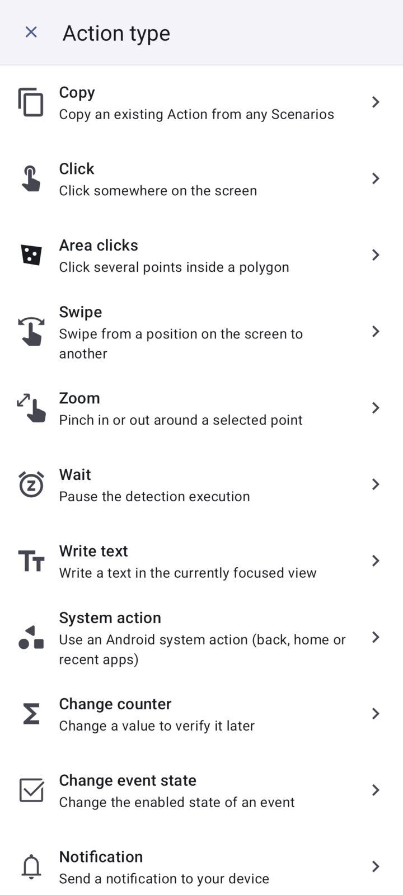
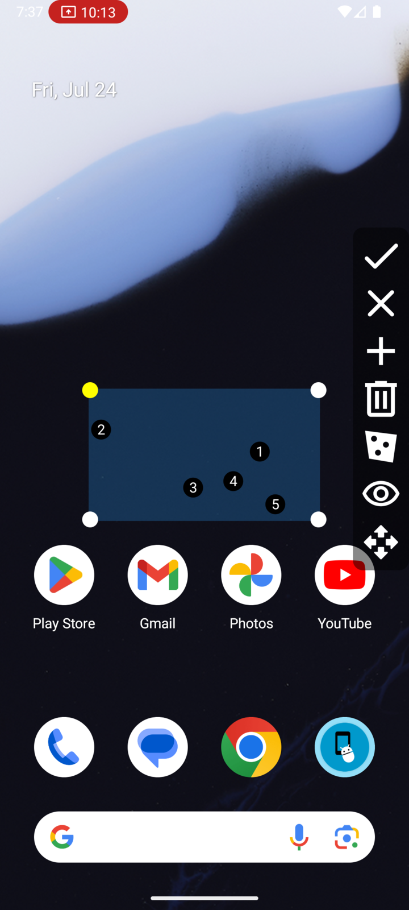
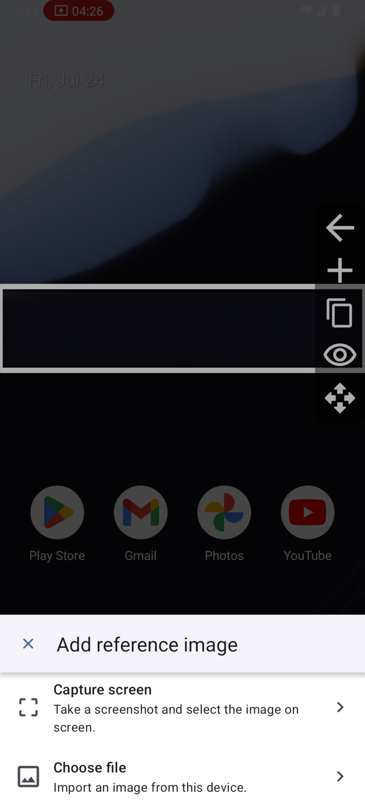
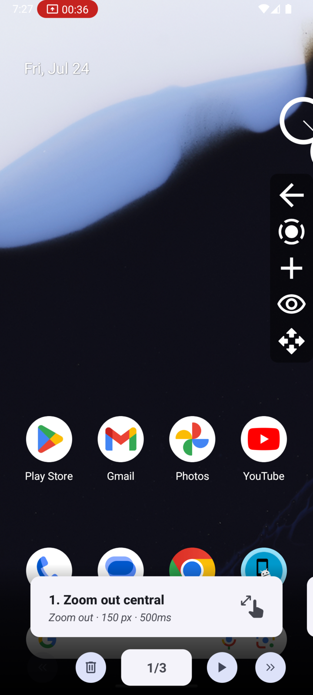

# Histórico de mudanças

Este arquivo registra mudanças relevantes da versão personalizada do Klick'r.
O formato segue o [Keep a Changelog](https://keepachangelog.com/pt-BR/1.1.0/)
e as versões seguem o [Versionamento Semântico](https://semver.org/lang/pt-BR/).

## [Não lançado]

## [4.0.0-beta06] - 2026-11-25

### Adicionado

- O modo Script executa pacotes JavaScript no Android. Os scripts aparecem na tela inicial e podem ser importados, editados e validados pela biblioteca.
- **Farm — vilas e muros 3.6.2** já vem no APK e aparece na tela inicial na primeira abertura. No cartão, configure suas vilas e escolha os parâmetros antes de iniciar. A versão inclui a calibração de referência para o Samsung SM-S916B em português e em paisagem, a 2340 × 1080.
- Cenários inteligentes podem pedir valores antes de iniciar e usar números reconhecidos na tela como operandos.

### Alterado

- O modo Script permite retomar rodadas compatíveis e tentar novamente após uma falha sem fechar o jogo. A instalação do farm integrado preserva os pacotes, cadastros e rodadas já salvos na mesma instalação.

### Corrigido

- O farm reconfirma saldos e contadores de tropas e feitiços antes de decidir. Quando esgota as tentativas de lançar uma unidade, segue para as fases restantes da batalha.
- O menu flutuante mantém os controles utilizáveis após redimensionamento. Pausar um cenário inteligente conserva seu progresso.

## [4.0.0-beta05] - 2026-07-24

### Adicionado

- Adicionada ação de zoom configurável para aproximar ou afastar em cenários inteligentes e regulares.
- Adicionada ação de toque em área poligonal, com escolha segura de um ponto dentro da região definida.
- Condições de imagem agora aceitam várias referências para reconhecer variações visuais do mesmo alvo.
- Condições de texto agora aceitam várias alternativas de palavras ou frases.
- Adicionadas tarefas para compilar e instalar automaticamente o APK compatível com o aparelho conectado.
- Adicionados testes de regressão para zoom, toque em área, textos alternativos, imagens alternativas, migrações e fluxos de edição.

### Alterado

- A geração FDroid produz APK universal e APKs específicos para `armeabi-v7a`, `arm64-v8a`, `x86` e `x86_64`.
- Adicionada migração do banco de dados para armazenar várias referências de imagem sem perder cenários existentes.
- Atualizados backup e restauração para preservar as novas referências.

### Capturas de tela

As telas abaixo foram registradas no emulador com a versão desta release.

  
  
  
  

[Não lançado]: https://github.com/MarlonPassos-git/Smart-AutoClicker/compare/4.0.0-beta06...HEAD
[4.0.0-beta06]: https://github.com/MarlonPassos-git/Smart-AutoClicker/compare/4.0.0-beta05...4.0.0-beta06
[4.0.0-beta05]: https://github.com/MarlonPassos-git/Smart-AutoClicker/compare/45545d23...4.0.0-beta05
